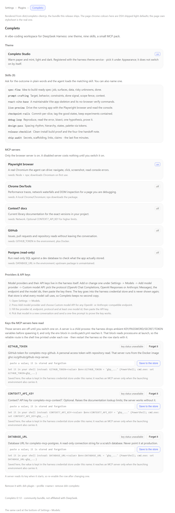

# Completo

> A community bundle for **DeepSeek Harness** that makes it a vibe-coding
> workspace: one calm theme, a nine-skill build loop, and a small MCP pack that
> lets the agent actually look at the app it is building.
>
> **Not affiliated with DeepSeek.** "DeepSeek Harness" is named only to say what
> this plugs into.

**Built and verified against DeepSeek Harness `0.2.2-rc.1`.** `engines.dsh` is
`>=0.2.2-rc.1 <0.3.0`; the harness refuses to import the bundle outside that
range.

---

## What you get

| Part | What it does | On by default |
| --- | --- | --- |
| **Completo Studio** theme | Warm paper + mint, light and dark, wired into the harness theme service. | Registered; pick it under *Appearance* |
| **Nine skills** | `spec-flow`, `prompt-crafting`, `react-vite-base`, `live-preview`, `checkpoint-rails`, `debug-loop`, `design-pass`, `release-checklist`, `ship-audit` | On |
| **Playwright browser (MCP)** | A real Chromium the agent drives: navigate, click, screenshot, read console errors. This is what makes *live-preview* more than words. | On |
| **Chrome DevTools (MCP)** | Performance traces and network waterfalls when a page misbehaves. | Off |
| **Context7 docs (MCP)** | Current docs for the exact library versions in your project. | Off |
| **GitHub (MCP)** | Issues, PRs and repo reads from the conversation. Needs a token. | Off |
| **Postgres (MCP)** | Read-only SQL against a dev database. Needs a URL. | Off |
| **Completo page** | Settings → Plugins → *Completo*: what is installed, what is on, and how to remove it. | On |
| **Providers & API keys card** | On that page: where a model provider and its key are added (the harness's own *Settings → Models*), plus write-only key slots for the environment variables the MCP rows read. | On |

Nothing is fetched at install time except the package itself. The Playwright
server downloads Chromium on its first run.

---

## What it looks like



This is the page the bundle adds under **Settings → Plugins → Completo**, rendered
from the shipped `dist/completo-client.js` with the harness's light-theme page
chrome. [`docs/screenshots/completo-page.html`](docs/screenshots/completo-page.html)
is the same render as plain HTML, and
[`docs/screenshots/`](docs/screenshots/) says how the image is regenerated.

The screenshot is generated from the built bundle, not taken from a live window:
see [Status and known limitations](#status-and-known-limitations) for what that
does and does not prove.

---

## Install

Completo is a **profile bundle**: one entry in your profile's
`dsh.profile.bundles`. Use the plugin CLI, which writes the profile for you.

### From a git tag (this is the release install)

```sh
dsh plugin --profile my-profile add 'github:itsnotalwin/dsh-completo#v0.1.0'
```

Pin the tag, not the branch: `main` moves, `v0.1.0` does not.

Installing from git runs the `prepare` script (`node scripts/build.mjs`). pnpm
refuses to run it until you allow that build; it prints the exact key in the
error. Add it to your **profile's** `pnpm-workspace.yaml` (e.g.
`~/.dsh/profiles/my-profile/pnpm-workspace.yaml`), then re-run the command:

```yaml
onlyBuiltDependencies:
  - dsh-completo
```

Older pnpm versions call the same idea `allowBuilds: { dsh-completo: true }` —
use whatever key the error message names. The build needs only Node: it copies
`src/` to `dist/`, inlines the palette and the shipped summary, and validates
the skill pack and the patch.

If you would rather not allow a build at all, download the release tarball
(`dsh-completo-0.1.0.tgz`) and add it — prebuilt, no scripts:

```sh
dsh plugin --profile my-profile add ./dsh-completo-0.1.0.tgz
```

### From a local checkout (how it was verified)

```sh
git clone https://github.com/itsnotalwin/dsh-completo.git
dsh plugin --profile my-profile add ./dsh-completo
dsh --profile my-profile --dump-config | grep completo
```

`--dump-config` should show the `# == dsh-completo` block with the `completo`
row and the five `completo-mcp-*` rows.

There is exactly **one** Completo row on purpose: the browser module registry
rejects two active composition sources for the same npm package, so the theme
and the Settings page are delivered through that row's single
`exports["./client"]` bundle instead of separate rows.

> **npm:** the package is not published to npm yet. When it is, the same command
> becomes `dsh plugin --profile my-profile add dsh-completo`, and it needs no
> build step because `dist/` is published.

---

## Switching the theme on

Registering a theme does not switch it on. In the web app:

**Settings → General → Appearance** — the appearance row only offers
light/dark/system, because that is the shipped control. The two Completo Studio
themes (`completo-studio-light`, `completo-studio-dark`) are registered with the
theme service and selectable through it; until a picker lists non-shipped
themes, the reliable way to use one is a profile patch:

```yaml
- id: ui-theme
  config:
    preference: light   # or dark / system
```

**Fonts are not applied by Completo.** The client theme service exposes no
font-family setter to plugins, so the suggested stacks from `src/theme/palette.js`
are for copy-paste into *Appearance → Font settings*:

```
Aptos Display, Aptos, Segoe UI Variable Display, Segoe UI Variable Text, Segoe UI, system-ui, -apple-system, BlinkMacSystemFont, Inter, Helvetica Neue, Arial, sans-serif
```

Aptos ships with recent Microsoft 365 installs; on a machine without it this
falls back to Segoe UI. Completo does not bundle or download a font.

---

## The skills

Ask for the outcome in plain words; the agent loads the matching skill. You can
also name one.

| Skill | Use when |
| --- | --- |
| `spec-flow` | An idea is still a sentence and you want a build-ready spec. |
| `prompt-crafting` | A prompt keeps producing almost-the-right thing. |
| `react-vite-base` | Starting or extending a React + Vite + TS app. |
| `live-preview` | You need to see the running app, not guess at it. |
| `checkpoint-rails` | Long builds where a bad slice could lose a good state. |
| `debug-loop` | Something broke and the cause is not obvious. |
| `design-pass` | Working, but it looks like a prototype. |
| `release-checklist` | Before handing the app to anyone. |
| `ship-audit` | Last five minutes: secrets, scaffolding, links, claims. |

The pack is read-only and offline: nine `SKILL.md` files under `skills/`.

---

## The MCP rows

Each row is its own composition entry, so you can flip one without touching the
rest. In your profile's `cordis.patch.yml`:

```yaml
- id: completo-mcp-chrome-devtools
  disabled: false
```

**Secrets are never written into this bundle.** The rows that need them read the
environment at boot through `!!js`:

| Variable | Used by |
| --- | --- |
| `CONTEXT7_API_KEY` (optional) | `completo-mcp-context7` |
| `GITHUB_TOKEN` | `completo-mcp-github` (passed as `GITHUB_PERSONAL_ACCESS_TOKEN`, Docker required) |
| `DATABASE_URL` | `completo-mcp-postgres` |

They are written as `!!js process.env.X ?? ''`, so a missing variable yields an
empty string instead of `undefined` — the MCP client validates each field
against a string schema and would otherwise reject the row.

Tool names arrive as `mcp__completo-mcp-playwright__<tool>` and so on.

### Why these five, and not more

- **Playwright is on** because it is first-party, needs no account, and closes
  the loop that vibe coding actually needs: change → look → judge.
- **Everything with a credential or a network dependency is off.** Turning those
  on is a deliberate act, not a side effect of installing a theme.
- **Skipped on purpose:** filesystem and git MCP servers (the harness already
  has better native tools), Figma/Linear/Stripe (nice, but this bundle is about
  building, not project admin), and any checkpoint/rewind plugin — use a
  dedicated one and keep Completo's `checkpoint-rails` skill for the git
  discipline around it.
- **`@modelcontextprotocol/server-postgres@0.6.2`** is the last release
  (2024-12) and is unmaintained. The row is off by default and the skill set
  never depends on it.

---

## Providers and API keys

Completo does **not** keep a provider list or a key store of its own, and it never
re-implements the model settings page. What it adds is one card that sends you to
the place that already does this safely, plus key slots for its own MCP rows.

### Adding a model provider

The harness owns this: **Settings → Models → Add model provider → Custom model
API**. Give it a provider id, an endpoint, a protocol (OpenAI Chat Completions,
OpenAI Responses or Anthropic Messages) and at least one model id, then paste the
API key. The key goes into the harness credential store and is never sent back to
the browser; `credentials/describe` only reports *set / not set*.

The Completo card lists those four steps, in order, so nobody has to guess where
the key input lives. Completo keeps no second copy and shows no key value.

### Keys the MCP rows read

| Variable | Used by |
| --- | --- |
| `CONTEXT7_API_KEY` (optional) | `completo-mcp-context7` |
| `GITHUB_TOKEN` | `completo-mcp-github` (passed as `GITHUB_PERSONAL_ACCESS_TOKEN`, Docker required) |
| `DATABASE_URL` | `completo-mcp-postgres` |

The card can store or clear each of these in the harness credential store, and it
reports their state through the write-only `credentials/describe` call — the value
never travels back to the UI.

**Be clear about the limit:** an MCP server is a child process, and the harness
scrubs ambient variables matching `KEY|PASSWORD|SECRET|TOKEN` before spawning it.
Only the `env:` block in `cordis.patch.yml` reaches the child, and that block reads
`process.env` at boot. So the reliable path is to **export the variable in the
shell that starts the harness** (the card prints the exact line). A value saved
from the card is kept under the same name in the credential store, which is what
you want for the record, but it only reaches the child on a launch whose
environment carries it.

---

## Turning it off / removing it

```sh
dsh plugin --profile my-profile remove dsh-completo
```

or delete `dsh-completo` from `dsh.profile.bundles` in the profile's
`package.json` and restart. Removing the bundle removes its rows; nothing else
in the profile is touched. Because `--from-default-profile` profiles are
throwaway, the safest way to try Completo is a fresh profile:

```sh
dsh plugin --profile completo-try add ./dsh-completo
dsh --profile completo-try web
```

---

## Development

```sh
npm run build   # src/ -> dist/, inlines palette + summary, validates skills + patch
npm run check   # syntax check every module, verify the patch/env contract
npm test        # node:test suites (skills parse, palette contrast, patch rows)
```

No dependencies, no toolchain: the bundle ships plain ESM so that verifying it
never needs anything installed into your profile.

Layout:

```
cordis.patch.yml      loader rows: 1 plugin row + 5 MCP servers
src/index.js          the host half: registers the skill provider
src/client-root.js    the browser bundle entry (module-loader wrapper)
src/client/theme.js   registers Completo Studio light + dark
src/client/page.js    the "Completo" settings page (one shared en dictionary)
src/client/providers.js  the Providers & API keys card + Models footer card
src/skills/           provider shaped like the shipped dsh-skill-office plugin
skills/<name>/SKILL.md the curriculum
scripts/              build + contrast + browser-half checks
scripts/render-page.mjs  renders the settings page to docs/screenshots/ for the README
docs/screenshots/     the README image, the HTML it is rendered from, and how to regenerate it
dist/                 built output (checked in so git installs behave; rebuilt on prepare)
```

---

## Status and known limitations

- **Verified** on a freshly initialised harness home (`DSH_HOME` pointed at a
  clean directory, profile `smoke` created with `dsh plugin --profile smoke add
  ./dsh-completo`): `--dump-config` lists every Completo row; booting that profile
  through the harness boot path mounts the plugin with no activation failure; the
  live skill registry lists **49** skills of which **9** come from provider
  `completo`, and loading `spec-flow` returns its full 2665-character body;
  enabling the Playwright row registers **25** `mcp__completo-mcp-playwright__*`
  tools (`browser_navigate`, `browser_click`, `browser_take_screenshot`,
  `browser_console_messages`, `browser_evaluate`, …) into the live tool set.
- **Skill loading is verified through the model-facing tool**, not only the
  registry: executing the `skill` tool on a live boot returns the full
  `SKILL.md` body (2898 characters for `spec-flow`, read from
  `skills/spec-flow/`) in about 600 ms, and an unknown name is rejected.
- **Tool calling is verified**: `mcp__completo-mcp-playwright__browser_navigate`
  was executed on a live boot (8273 ms) against `https://example.com` and
  returned the real page title.
- The browser half was verified against the harness's **real** client
  composition and module system: the registry resolves
  `dist/completo-client.js`, accepts the package (no "multiple composition
  sources" error), the composed graph lists `dsh-completo` once, and importing
  the bundle yields `{name: "completo", inject: ["theme","slots","locale",
  "remote","remote.credentials"], apply}`. It registers both themes (14 tokens
  each), the one English dictionary (33 strings), the Settings → Plugins tab and
  the Settings → Models footer card.
- **Page appearance is verified from the shipped bundle, not from a live window.**
  `scripts/render-page.mjs` renders the real component with the real stylesheet to
  `docs/screenshots/completo-page.html`, and a headless browser turns that into the
  README image; regenerating it is how the three layout bugs it exposed were found
  and fixed. It does not prove how the page sits inside a running Harness window
  (live tokens, real fonts, sidebar).
- **Not verified here:** the visual result of the theme in a running web UI (no
  browser session was attached — the themes are contract-checked and registered
  through the real theme service, not seen on screen), and a complete
  model-driven conversation in a headless profile (the desktop app signs in with
  an account credential such a profile cannot use). Skill and tool calling were
  exercised directly through the harness's own execution path instead.
- **No Projects sidebar.** Making the sidebar read like ChatGPT/Claude projects
  is the planned v0.2.0 milestone; the harness already models workspaces as
  projects, so it is presentation work, not new storage.
- **No plugin-browser restyling.** Completo adds its own page under Plugins and
  leaves the harness's own screens alone.
- **No icon replacement set.** The shipped icon sprite contract (`ICON_SYMBOLS`)
  could not be verified from the installed app, so v0.1.0 ships no icons rather
  than guessing names.

## Licence

MIT — see [LICENSE](./LICENSE). Attribution notes in [NOTICE](./NOTICE).
Changes in [CHANGES.md](./CHANGES.md).
